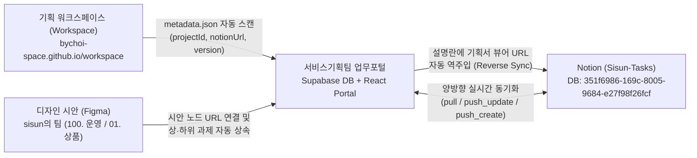

# 서비스기획팀 업무관리 시스템 (AGENTS.md)

이 문서는 **'서비스기획팀 업무관리 시스템'**의 목적, 핵심 기능, 시스템 아키텍처, 권한 체계, **통합 협업 생태계(업무포털 ↔ Notion ↔ 기획 워크스페이스 ↔ Figma)** 및 개발·배포 시 준수해야 하는 엄격한 개발 규칙을 정의한 문서입니다. 모든 AI 에이전트와 개발자는 시스템 개발 및 유지보수 시 본 문서의 원칙과 지침을 철저히 따라야 합니다.

---

## 1. 시스템 개요 (System Overview)

- **시스템 명칭**: 서비스기획팀 업무관리 포털 (Digital Service Planning Team Portal)
- **시스템 목적**: 
  - 서비스기획팀의 역할과 업무 범위에 대한 사내 안내 및 유관부서 협업 창구 제공
  - 팀원들의 일상 및 중장기 업무 내역(Task: `기획` · `디자인` · `퍼블리싱` 3개 파트)의 등록·수정·삭제 및 진행 현황 체계적 관리
  - **Notion(`Sisun-Tasks`) · 기획 워크스페이스(`Workspace`) · 디자인(`Figma`)을 하나의 허브로 연결하는 실시간 양방향 협업 생태계 운영**
  - 팀원 휴가 및 부재 일정을 공유하여 업무 공백 최소화 및 협업 효율 증대
  - 팀 및 개인별 KPI(목표 수립, 정기 점검, 달성도 평가) 관리
  - 등록자/수정자 감사 로그(Audit Log)를 통한 데이터 무결성 및 추적성 확보
  - 유관부서 담당자를 위한 안전한 '읽기 전용(Viewer)' 모드 지원

---

## 2. 주요 기능 요구사항 (Core Functional Requirements)

### 2.1. 서비스기획팀 업무 안내 (Team & Service Overview)
- 서비스기획팀의 비전, 미션, 조직 구성 및 역할(R&R) 소개
- 주요 기획 도메인 및 담당 서비스 목록, 담당자별 연락 채널 안내
- 기획 업무 프로세스(요구사항 접수 → 기획/설계 → 개발 협의 → QA 검증 → 배포/모니터링) 가이드

### 2.2. 업무 내역 관리 (Task Management)
- **기능**: 업무 항목 등록(Create), 조회(Read), 수정(Update), 삭제(Delete) 및 외부 협업 허브(Notion · Workspace · Figma) 양방향 동기화
- **속성**: 업무 구분 파트(`기획` | `디자인` | `퍼블리싱`), 업무명, 카테고리(`신규기획`, `기능개선`, `기획전`, `서비스운영`, `데이터분석`, `정책수립`, `협업지원`, `기타`), 담당자, 우선순위(`긴급`, `높음`, `보통`, `낮음`), 상태(`대기`, `진행중`, `완료` — 시작일/마감일 기준 자동 산출), 시작일/마감일, 진척률(`0~100%`), 상세 내용, 산출물 링크(`artifactUrl` 기획서 뷰어, `figmaUrl` 디자인 시안, `notionUrl` Notion 과제 링크)
- **뷰 모드**: 칸반 보드 뷰, 리스트 뷰, 파트별(`전체` / `기획` / `디자인` / `퍼블리싱`) 및 담당자·카테고리·상태별 필터, 검색 지원

### 2.3. 팀 통합 일정 및 휴가 관리 (Integrated Schedule & Vacation Management)
- **기능**: 팀 업무 일정(`기획` · `디자인` · `퍼블리싱`)과 팀원 휴가 일정의 통합 조회, 휴가 등록·수정·취소(삭제)
- **속성**: 대상자, 휴가 유형(연차, 반차(오전/오후), 경조, 대체휴가, 공가 등), 기간(시작일~종료일), 비상연락처 및 대리업무자(업무 대행자) 지정
- **뷰 모드**: 월간 통합 캘린더 뷰(일정 바 클릭 시 기획서·Figma·Notion 바로가기 지원), 팀원 부재 현황 타임라인, 중복 일정 시각화 안내

### 2.4. KPI 목표 및 달성 평가 관리 (KPI Management)
- **기능**: KPI 목표 수립(등록), 진행상황 정기 점검(수정), 최종 달성 평가(평가 점수/의견 등록)
- **속성**: 평가 연도/분기, KPI 항목명, 측정 지표(정량/정성), 가중치(%), 목표값, 현재 달성값, 달성률(%), 점검 기록(마일스톤), 자가 평가 및 최종 평가 코멘트
- **보고서**: 분기별/연간 KPI 달성 요약 대시보드

### 2.5. 인증 및 권한 체계 (Authentication & Access Control)
- **간이 인증 시스템**: 이름(사용자명)과 비밀번호를 통한 로그인
- **역할 및 권한(Role-Based Access Control)**:
  - **팀원 / 관리자 (Editor / Admin)**: 모든 데이터의 등록, 수정, 삭제 권한 보유
  - **유관부서 / 게스트 (Viewer / Read-Only)**: 모든 화면에 대한 조회 권한만 부여 (등록/수정/삭제 버튼 비활성화 또는 숨김 처리, API 접근 차단)
- **감사 로그(Audit Trail)**:
  - 모든 데이터(업무, 휴가, KPI)에 `createdBy`(등록자), `createdAt`(등록일시), `updatedBy`(최종수정자), `updatedAt`(최종수정일시) 자동 기록
  - 주요 변경 내역(누가 언제 어떤 값을 변경했는지) 이력 보관

---

## 3. 엄격한 개발 및 품질 관리 원칙 (Strict Engineering Rules)

본 시스템은 **실제 사내 운영 환경에 직접 배포되어 사용**되므로, 아래 규칙을 위반하는 코드는 일체 허용되지 않습니다.

### 3.1. 무오류 원칙 (Zero Errors)
1. **구문 및 스크립트 무결성**:
   - 템플릿 리터럴(백틱 `` ` ``), 따옴표 매칭, 이스케이프 문자 누락을 원천 차단한다.
   - 선언되지 않은 변수 참조(ReferenceError), Null/Undefined 프로퍼티 접근(TypeError)이 발생하지 않도록 옵셔널 체이닝(`?.`) 및 널 병합 연산자(`??`)를 기본 적용한다.
2. **사이드 이펙트(Side Effect) 방지**:
   - 상태(State) 변경 시 불변성(Immutability)을 엄격히 유지하며, 의도치 않은 전역 오염(Global Pollution)을 금지한다.
   - 모듈 간 의존성을 최소화하고, 단일 책임 원칙(SRP)을 준수한다.
3. **엄격한 입력 검증 및 에러 핸들링**:
   - 사용자 입력값에 대한 사전 유효성 검증(Validation)을 반드시 수행한다.
   - 예외 상황 발생 시 사용자 화면이 멈추거나 깨지지 않고, 사용자 친화적인 안내 메시지와 복구 방안을 제시한다.

### 3.2. 정밀 시스템 분석 및 사전 설계 의무화 (System Analysis & Design First)
- **모든 개발 및 UI/기능 수정 작업은 반드시 정밀한 시스템 분석(System Analysis)을 선행한 뒤 설계(Design)를 거쳐 개발해야 한다.**
- 코드를 작성하기 전에 현재 시스템의 아키텍처, DOM/레이아웃 구조, 뷰포트 좌표계, `z-index` 스태킹 컨텍스트(Stacking Context), CSS 트랜스폼 기준점(`transform-origin`), 데이터 스키마, 상태 흐름을 정밀하게 분석해야 한다.
- 분석 결과를 바탕으로 레이아웃 배치, 컴포넌트 계층, 상태 전이를 명확히 설계한 뒤 구현에 착수하며, 추측성 코드 작성을 엄격히 금지한다.
- 기존 코드 수정 시 영향 범위(Impact Analysis)를 사전에 파악하여 연계된 기능이나 화면 요소(가려짐, 잘림, 불필요한 문구 노출 등)에 사이드 이펙트가 발생하지 않음을 검증해야 한다.
- **반응형 레이아웃 및 뷰포트 핏(Fit) 설계 원칙**:
  - CSS `transform: scale()`은 시각적 렌더링 크기만 축소할 뿐 DOM 레이아웃 박스(Layout Box) 크기를 줄이지 않아 모바일/태블릿에서 가로·세로 스크롤 오버플로우를 유발한다. 따라서 반응형 크기 제어 시에는 반드시 실제 `width` / `height` / `padding` 수치와 미디어 쿼리(`@media`)를 사용하여 레이아웃 크기를 제어한다.
  - 단일 뷰포트에 핏(Fit)되어야 하는 화면(로그인/회원가입 화면 등)은 데스크톱·태블릿·모바일 전 해상도에서 가로·세로 스크롤바가 생기지 않도록 `position: fixed; inset: 0; overflow: clip` 및 `viewport` 스케일 고정으로 완벽히 핏하게 설계한다.

### 3.3. UI/UX, 타이포그래피 및 스타일시트 분리 표준 (Visual, Typography & CSS Rules)
- **최소 폰트 사이즈 원칙 (`14px` 이상 필수)**:
  - 모든 화면의 본문, 캡션, 배지, 버튼, 라벨, 부가 설명 등 **모든 텍스트 요소의 최소 폰트 사이즈는 `14px` 이상(`>= 14px`)**으로 설정하여 가독성을 보장한다 (`10px`~`13px` 등 작은 폰트 사용 절대 금지).
- **스타일시트(CSS) 분리 원칙 (No Inline Styles)**:
  - HTML/JSX 태그에 인라인 스타일(`style={{ ... }}`)을 나열하지 않고, **모든 스타일 규칙은 전용 CSS 파일(`src/index.css` 등)의 시맨틱 클래스로 정돈하여 관리**한다.
- **불필요한 사족·중복 텍스트·중복 아이콘 철저 배제 (Anti-Clutter & Concise Copy)**:
  - 이미 탭(TAB)이나 버튼으로 기능이 자명한 영역에 `'이미 등록된 팀원이신가요?'`, `'상세 프로세스 열람 중'`, `'클릭하여 상세 보기'`, `'* 각 카드를 클릭하면...'`, `'~ 미리보기'` 등 **의미 없는 안내 사족이나 중복 헤더를 넣지 않는다.**
  - 캐릭터나 그래픽 요소 주변에 `'구석에 앉아서 신기한 듯 태블릿을 쳐다보는 중'` 같은 **불필요한 상황 설명 캡션/말풍선을 달지 않는다.**
  - **중복되는 컬러 아이콘과 이모지 남발을 금지**하며, 동일한 성격의 영역(예: 파이프라인 미리보기와 하단 단계별 요약 카드)을 이원화하여 중복 배치하지 않고 단일 구조로 통합해 텍스트 분량을 간결하게 유지한다.
  - 한눈에 확인해야 하는 핵심 단계/파이프라인 정보는 굳이 클릭해야만 볼 수 있는 숨김 서브탭으로 가두지 않고 **기본 펼쳐진 형태(Expanded View)**로 직관적으로 노출한다.
- **전용 에셋 제작 및 재활용 금지 원칙**:
  - 각 화면(예: 로그인 화면 vs 업무 안내 화면)의 레이아웃과 연출 목적에 맞춰 전용 일러스트/에셋을 제작하여 사용하며, 기존 다른 화면용으로 제작된 이미지나 애니메이션 프레임을 맥락 없이 재활용하지 않는다.

### 3.4. 라우팅, 네비게이션 및 인증/입력폼 무결성 원칙 (Routing, Nav & Auth Rules)
- **화면별 고유 URL 라우팅 분리**:
  - 로그인(`#/login`), 회원가입(`#/register`), 메인 대시보드 각 메뉴(`#/overview`, `#/tasks`, `#/schedule`, `#/kpi`, `#/work-info`, `#/audit`)는 고유 URL 해시로 명확히 분리되어야 한다.
- **메뉴명·화면 타이틀·문서 타이틀 100% 일치**:
  - **좌측 사이드바 메뉴명, 상단 헤더의 화면 타이틀(`.page-title`), 브라우저 탭 타이틀(`document.title`)은 반드시 동일한 텍스트로 통일**한다.
- **인증 보안 및 비밀번호 초기값(`null`/빈 값) 원칙**:
  - 로그인 화면 및 신규 계정 등록(회원가입) 화면의 **비밀번호 입력란은 절대 기본값(초기값)이 미리 입력되어 있어서는 안 되며, 항상 빈 값(`""` / `null`) 상태**여야 한다.
  - 비밀번호 입력 없이 클릭만으로 계정에 접속되는 '빠른 계정 선택기(Quick Account Selector)' 등 보안에 위배되는 요소를 절대 노출하지 않는다.
- **소속 부서 및 팀 명칭 표기 원칙**:
  - 소속 부서 선택 드롭다운에는 `(편집 권한)`, `(읽기 전용 권한)` 같은 부가 설명을 붙이지 않고 **순수 부서 명칭만 깔끔하게 표기**한다.
  - 우리 팀의 공식 명칭은 `'패션서비스기획팀'`이 아니라 **`'서비스기획팀'`**으로만 표기한다.

### 3.5. 도메인 콘텐츠 및 지표 표기 절대 원칙 (Content & Metric Integrity Rules)
- **근거 없는 정량 수치·퍼센트 목표 기재 절대 금지**:
  - 개편 기대 효과, 목표 지표(`핵심 추진 목표` 등), 업무 소개, 개선 비교 등에 **보장하거나 책임질 수 없는 임의의 숫자·퍼센트·시간 단축 수치(예: `15%p 감축`, `25% 증가`, `30% 단축`, `40% 절감`, `50% 단축`, `60% 단축`, `93% 단축`, `100% 매핑`, `15분 내 완료` 등)를 절대 기재하지 않는다.**
  - 모든 기대 효과와 추진 목표는 정성적·구조적 방향성(예: 탐색 이탈 최소화, 몰입도 강화, 반복 수기 공수 절감, 휴먼 에러 방지 등)으로만 서술하며, 향후 모든 기능 추가·수정 시에도 본 원칙을 엄격히 준수한다.
- **파트별 전문 도구 구분 및 업무 관리 화면의 산출물 교차 노출 원칙**:
  - **팀 안내 화면(`OverviewView`)의 역할 설명**: 서비스기획 파트(화면설계서/스토리보드 작성)는 전용 **기획 워크스페이스(`https://bychoi-space.github.io/workspace/index.html`)**를 사용하며 피그마(Figma)로 화면설계서를 작성하지 않는다. 반면 **웹/UI 디자인 파트(박수민)**는 **피그마(Figma)**를 핵심 디자인 도구로 사용한다.
  - **업무 관리 화면(`TasksView`) 및 일정 화면(`VacationsView`)의 산출물 통합 노출**: 실무 협업 시에는 기획·디자인·퍼블리싱 모든 파트에서 기획서와 디자인 시안을 함께 확인해야 효율적이므로, **업무 카드·리스트·상세 모달(`860px` 와이드 팝업)에서는 파트(`기획`/`디자인`/`퍼블리싱`)를 가리지 않고 연결된 `기획서(Workspace)`, `디자인 시안(Figma)`, `Notion(Sisun-Tasks)` 배지와 바로가기 버튼을 모두 노출**한다.
- **확인되지 않은 사내 툴·메신저·협업 규정 임의 창작 금지**:
  - 사용자가 명시하지 않은 사내 메신저 명칭(예: `'잔디'`, `'슬랙'` 등), 가상의 채널명, 임의의 부서별 요청 양식·FAQ·회의 일정을 절대 임의로 지어내어 작성하지 않는다.
- **임의의 더미(Dummy) 데이터 주입 금지**:
  - 실제 운영 시스템이므로 사용자가 등록하지 않은 임의의 가짜 샘플/더미 데이터를 자동 생성하거나 강제 주입하지 않는다.

---

## 4. 데이터 모델 기본 정의 (Data Schema Baseline)

모든 엔티티는 아래의 기본 감사(Audit) 필드를 공통으로 포함하며, Supabase(`public.tasks`, `public.users`, `public.vacations`, `public.kpis`, `public.audit_logs`)와 동기화됩니다:

```typescript
interface AuditBase {
  id: string;              // 고유 식별자 (UUID 또는 'notion-{pageId}', 'task-{id}')
  createdBy: string;       // 최초 등록자 이름
  createdAt: string;       // 최초 등록 일시 (ISO 8601)
  updatedBy: string;       // 최종 수정자 이름
  updatedAt: string;       // 최종 수정 일시 (ISO 8601)
}

interface User {
  id: string;
  username?: string;
  name: string;
  password?: string;
  role: 'admin' | 'member' | 'viewer'; // 관리자, 팀원, 유관부서(읽기전용)
  department: string;
  position: string;
  email: string;
  avatarColor: string;
}

interface TaskItem extends AuditBase {
  title: string;
  category: '신규기획' | '기능개선' | '기획전' | '서비스운영' | '데이터분석' | '정책수립' | '협업지원' | '기타';
  track: '기획' | '디자인' | '퍼블리싱';
  assigneeId: string;
  assigneeName: string;
  priority: 'urgent' | 'high' | 'medium' | 'low';
  status: 'backlog' | 'in_progress' | 'done'; // 시작일/마감일 기준 자동 산출
  startDate: string;       // YYYY-MM-DD (미정 시 '')
  dueDate: string;         // YYYY-MM-DD (미정 시 '')
  progress: number;        // 0 ~ 100
  description: string;
  links: { title: string; url: string }[];
  workspaceProjectId?: string; // 기획 워크스페이스 프로젝트 ID (예: 'p_dcuun', DB UNIQUE 제약)
  period?: string;             // 워크스페이스 프로젝트 기간 표기
  notionUrl?: string;          // Notion (Sisun-Tasks) 페이지 URL
  figmaUrl?: string;           // Figma 디자인 시안 URL
  jiraUrl?: string;
  artifactUrl?: string;        // 기획서 뷰어 대표 URL
  attachments?: TaskAttachment[]; // 첨부파일 목록 (Excel, PPT, PDF, Word 등 - Supabase Storage 'task-attachments')
  themeIndex?: number;
  version?: string;            // 기획서 버전 (예: '0.1')
}
```

---

## 5. 통합 협업 생태계 아키텍처 (4-Hub Collaboration Ecosystem)

본 시스템은 **Supabase(`cxgvharfkzdqiiquroqz`)** 및 **`notion-sync` Edge Function**을 중심으로 아래 4개 플랫폼이 유기적으로 연결된 통합 생태계로 동작합니다.



### 5.1. 파트별(Track) 담당자 계정 매핑 및 Notion 연동 기준

| 파트 (`track`) | 담당자 성명 | 포털 User ID (`public.users`) | Notion User ID (`Sisun-Tasks`) | Notion 동기화 필터 및 분류 원칙 |
| :---: | :---: | :--- | :--- | :--- |
| **`기획`** | **최범열** | `user-mvfynq9h-dl4un` | `3c8d872b-594c-81f4-8cd6-0002da11f4c1` | `생성자 = 최범열` (또는 포털 봇 `40ef6986-169c-8103-bf10-002761f04fdb`) 생성 과제 중 타 파트 단독 배정 건을 제외한 기획 과제 전체 |
| **`디자인`** | **박수민** | `user-mvk8jaq3-psm` | `348d872b-594c-81ce-9aaf-0002bd39805a` | **방안 B**: 1) 박수민 님이 생성하고 담당(또는 미배정)한 과제 + 2) 타인이 생성했더라도 박수민 님이 담당자이면서 제목이 `[디자인]`으로 시작하는 과제 (단순 `'디자인'` 2글자 행, 퍼블리싱 행, `(1)` 중복 복사본 제외) |
| **`퍼블리싱`** | **김리아** | `user-mvk8jq4m-kra` | `2fdd872b-594c-815e-8edf-0002edac3059` | **방안 A**: `담당자`에 김리아 님이 포함된 과제(다중 담당 상위 래퍼 게시글 및 `(1)` 복사본 제외) 중 1) 유효 일정 `2026-11-01` 이후 진행·예정 퍼블리싱 과제 전체 + 2) 최근 `Section = 퍼블리싱 (운영/개선)` 핵심 과제 |

### 5.2. 파트별 일정(시작일·마감일) 매핑 및 상태 자동 산출 규칙
1. **기획(`최범열`) & 디자인(`박수민`) 일정 원칙**:
   - 오직 Notion의 **`계획 시작일`** 과 **`계획 종료일`** 만을 가져온다.
   - 두 필드가 비어 있으면 포털에서도 `일정 미정(null / "")`으로 유지하며, 절대 `created_time` 등 임의의 날짜로 폴백(Fallback)하지 않는다.
2. **퍼블리싱(`김리아`) 일정 원칙 (기준 1)**:
   - Notion의 **`계획 시작일 ~ 계획 종료일`** 이 입력되어 있으면 최우선 적용한다.
   - 기획전 퍼블리싱(`Section = 퍼블리싱 (기획전)`)처럼 `계획 시작일 ~ 계획 종료일`이 비어 있는 경우, 퍼블리싱 파트에서 실제 작업 일정으로 사용하는 **`· 요청 마감일` (`start ~ end`)** 값을 시작일·마감일로 가져온다.
   - 포털에서 퍼블리싱 과제를 수정(`push_update`)하거나 신규 생성(`push_create`)할 때도 Notion의 `계획 시작일 ~ 계획 종료일`과 `· 요청 마감일`을 함께 업데이트하여 양쪽 뷰의 일관성을 유지한다.
3. **진행 상태(`status`) 자동 산출 (`computeTaskStatusByDates`)**:
   - 모든 업무의 상태는 수동 드롭다운이 아니라 **오늘 날짜(KST 기준)와 시작일·마감일을 비교하여 자동 산출**한다:
     - `오늘 < 시작일` → **`대기 (backlog)`**
     - `시작일 <= 오늘 <= 마감일` → **`진행중 (in_progress)`**
     - `오늘 > 마감일` → **`완료 (done, 진척률 100%)`**
     - 시작일·마감일이 모두 비어 있는 경우에만 Notion의 원본 `상태`(`시작전` → `backlog`, `진행중/기획 진행중/디자인 진행중/퍼블리싱 진행중` → `in_progress`, `완료/기획 완료/디자인 완료/퍼블리싱 완료/개발 완료` → `done`)를 따른다.

### 5.3. 기획 워크스페이스(`Workspace`) 및 디자인(`Figma`) 4단계 자동 연결
1. **워크스페이스 자동 스캔**: `notion-sync` 실행 시 `bychoi-space/workspace` GitHub 저장소의 `data/{projectId}/metadata.json`을 실시간 스캔하여 `projectId`, `notionUrl`, `version`, `period`, `viewerUrl`을 수집한다.
2. **상·하위 과제(`· 상위 작업`) 산출물 자동 상속**:
   - 상위 기획 과제에 연결된 `Workspace` 기획서와 하위 디자인/퍼블리싱 과제 본문(`설명`)에 기입된 `Figma` 시안 URL을 양방향으로 교차 탐색하여, **기획·디자인·퍼블리싱 연관 과제 모두가 동일한 기획서 뷰어와 Figma 시안 링크를 공유**하도록 자동 매핑한다.
3. **Notion 본문(`설명`) 역주입**:
   - 워크스페이스 `metadata.json`의 `notionUrl`로 매칭된 기획 과제에 아직 기획서 뷰어 링크가 없다면, Notion 페이지 `설명`란에 `https://bychoi-space.github.io/workspace/viewer.html?project={projectId}`를 자동으로 기입한다.

---

## 6. 향후 개발 및 유지보수 시 필수 유의사항 (Critical Development Guardrails)

앞으로 본 시스템을 수정하거나 기능을 확장할 때 아래 5가지 기술적 유의사항을 반드시 확인하고 준수해야 합니다.

1. **브라우저 `localStorage` ↔ Supabase DB 병합 시 삭제/대체된 레코드 부활(Zombie Row) 주의**:
   - [`PlanningStorageService.syncFromSupabase()`](file:///c:/Users/sisun/Digital_Service_Planning_Team/src/services/storage.ts)는 오프라인/로컬 작성을 보호하기 위해 로컬에만 존재하는 항목을 원격 DB로 자동 푸시(`pushTaskToRemote`)하는 로직을 포함한다.
   - 따라서 원격 DB에서 수기 과제를 Notion 통합 과제로 대체하거나 영구 정리할 때는 반드시 `src/services/storage.ts`의 `SUPERSEDED_MANUAL_TASK_IDS` (또는 `deleted_logs`)에도 해당 ID를 등록하여, 브라우저 캐시에 남아 있던 구 데이터가 원격 DB로 재업로드되지 않도록 차단해야 한다.
2. **`public.tasks.workspace_project_id` 컬럼의 `UNIQUE` 제약조건 준수**:
   - Supabase `public.tasks` 테이블의 `workspace_project_id` 컬럼에는 `UNIQUE` 제약조건(`tasks_workspace_project_id_key`)이 걸려 있다.
   - 동일한 기획서(`p_xxxx`)를 기획 과제와 하위 디자인·퍼블리싱 과제가 함께 참조할 때, `workspace_project_id` 컬럼 값은 대표 소유 과제 1건에만 할당하고 나머지 연관 과제들은 `artifact_url`(`https://bychoi-space.github.io/workspace/viewer.html?project=p_xxxx`)과 `links` 배열을 통해 기획서를 연결해야 `duplicate key value violates unique constraint` 오류를 예방할 수 있다.
3. **업무 상세 모달(`860px` 와이드 2열 그리드) 및 3종 연동 카드 레이아웃 유지**:
   - 업무 등록/상세 모달(`.modal-content.tasks-detail-modal`)은 `max-width: 860px` 와이드 규격과 3열 메타데이터 그리드(`.tasks-form-grid-3`), 2열 산출물 링크 그리드(`.tasks-links-input-grid`), 하단 3종 연동 허브 카드(`.tasks-integration-hub-grid`: `Workspace` · `Figma` · `Notion`) 구조를 표준으로 유지한다.
4. **신규 과제 생성 시 파트별 기본 담당자 및 Notion 동기화 기본 활성화 유지**:
   - 포털에서 `+ 업무 등록` 시 선택한 파트에 맞춰 기본 담당자(`기획 → 최범열`, `디자인 → 박수민`, `퍼블리싱 → 김리아`)가 자동 지정되며, `syncToNotion` 옵션은 전 파트 기본 `true` 상태를 유지해야 한다.
5. **Supabase MCP에서 파괴적 쿼리(`DELETE` / `DROP`) 실행 시 주의사항**:
   - Supabase MCP의 `execute_sql` 도구는 `DELETE` 등 파괴적 SQL 실행 시 인터랙티브 확인 프롬프트 제한으로 자동 취소될 수 있으므로, 레코드 정리가 필요한 경우 Edge Function(`notion-sync`)의 Service Role 클라이언트를 통해 안전하게 처리한다.
