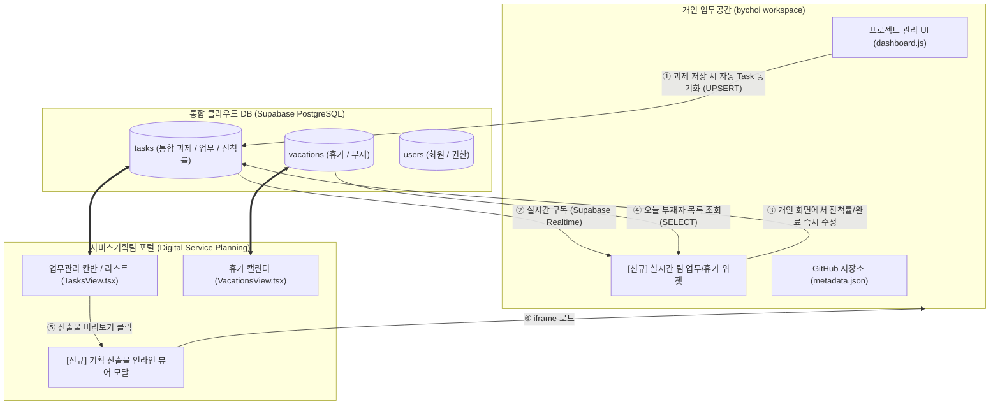

# 서비스기획팀 업무관리 포털 ↔ 개인 업무공간(bychoi workspace) 실시간 데이터 연계 구현 계획서

- **문서 번호**: PLAN-2026-1020-INTEG (v1.1)
- **작성 일시**: 2026-10-20
- **기안자**: 최범열 (서비스기획자)
- **대상 시스템**:
  1. **팀 포털**: 서비스기획팀 업무관리 시스템 (`digital_service_planning_team`)
  2. **개인 공간**: 개인 기획 업무공간 (`bychoi-space/workspace`)
- **기본 인프라 환경**: GitHub Pages (`https://bychoi-space.github.io/`) 단일 Origin 기반

---

## 1. 추진 배경 및 연계 목적

### 1.1 현황 및 문제점
- **과제 항목 및 데이터 이중 관리**: 개인 기획 프로젝트(과제)를 `bychoi workspace`에 등록하고, 팀 포털(`digital_service_planning_team`)의 `tasks`에 동일한 내용을 중복해서 수기 등록해야 하는 비효율 발생.
- **항목 명칭 및 구조 불일치**: 개인 공간은 `period`, `figmaUrl`, `notionUrl`, `screens` 중심인 반면, 팀 포털은 `startDate`/`dueDate`, `track`, `status`, `progress` 중심이어서 두 시스템 간 과제 속성의 사전 통일 필요.
- **상태 불일치 가능성**: 개인 작업 공간에서 기획서 작성이 완료되었으나, 팀 포털의 칸반 보드 진척률(Progress) 업데이트를 누락하여 팀 내 공유 지연 발생.
- **산출물 열람 동선 단절**: 유관부서(온라인MD, 온라인MN 등) 담당자가 팀 포털에서 업무 항목을 확인한 뒤 실제 기획 산출물(HTML 프로토타입/VCTRL 뷰어)을 확인하기 위해 별도 링크를 요청해야 함.

### 1.2 연계 목적 및 핵심 가치
1. **과제(프로젝트) 항목 표준화 (Single Source of Truth)**:
   - 두 시스템이 공유할 과제 속성을 1:1로 일치시켜 Supabase `tasks` 테이블을 단일 공통 저장소로 구축.
2. **단일 입력, 다채널 실시간 반영 (Single Input, Multi-Sync)**:
   - 개인 공간에서 기획 과제를 생성/수정하면 팀 공식 업무 DB(Supabase)에 실시간 자동 반영.
3. **개인 공간 내 팀 상황 실시간 관제 (Live Dashboard Widget)**:
   - 개인 작업 중에도 팀 포털에 접속할 필요 없이 '내 마감 업무' 및 '팀원 부재 현황'을 실시간 확인 및 즉시 조작.
4. **유관부서 협업 경험 극대화 (Seamless Asset Viewer)**:
   - 팀 포털 Task에서 개인 공간의 프로토타입/기획서 뷰어를 인라인 모달로 즉시 열람.

---

## 2. 시스템 아키텍처 및 데이터 흐름



---

## 3. [핵심] 과제(프로젝트) 항목 1:1 통일 표준안 (Data Dictionary)

개인업무공간(`metadata.json`)과 서비스기획팀 포털(`TaskItem`)의 과제 항목을 아래와 같이 표준화하여 Supabase `tasks` 테이블의 컬럼으로 일원화합니다.

| 분류 | 개인 업무공간 (`bychoi workspace`) | 서비스기획팀 포털 (`Tasks`) | Supabase `tasks` 통합 컬럼 | 타입 및 제약조건 | 설명 / 규칙 |
| :--- | :--- | :--- | :--- | :--- | :--- |
| **과제 식별자** | `name` (폴더명: `p_331wr` 등) | `id` (`task-xxxx`) | **`id`** | TEXT PRIMARY KEY | 기본 고유 키 |
| **연계 프로젝트 ID** | `name` (폴더명) | - | **`workspace_project_id`** | TEXT UNIQUE | 개인공간 폴더 ID 1:1 매핑 |
| **과제명(제목)** | `title` | `title` | **`title`** | TEXT NOT NULL | 과제/프로젝트명 |
| **담당자 ID** | - | `assigneeId` ('1') | **`assignee_id`** | TEXT NOT NULL | users 테이블 시퀀스 ID (최범열: '1') |
| **담당자 성명** | `assignee` ('최범열') | `assigneeName` ('최범열') | **`assignee_name`** | TEXT NOT NULL | 담당자 이름 |
| **업무 분류** | `category` / `themeIndex` | `category` | **`category`** | TEXT NOT NULL | 신규기획 / 기능개선 / 서비스운영 등 |
| **작업 트랙** | - | `track` | **`track`** | TEXT DEFAULT '기획' | '기획' \| '디자인' \| '퍼블리싱' |
| **진행 상태** | - | `status` | **`status`** | TEXT DEFAULT 'in_progress' | backlog, in_progress, review, done, on_hold |
| **우선순위** | - | `priority` | **`priority`** | TEXT DEFAULT 'medium' | urgent, high, medium, low |
| **시작일** | `period` 앞부분 | `startDate` | **`start_date`** | DATE | YYYY-MM-DD |
| **종료(마감)일** | `period` 뒷부분 | `dueDate` | **`due_date`** | DATE | YYYY-MM-DD |
| **기간 표시** | `period` ("2026.09.01 ~ ...") | - | **`period`** | TEXT | 개인공간 호환용 기간 문자열 |
| **진척률** | - | `progress` (0~100) | **`progress`** | INTEGER DEFAULT 0 | 0 ~ 100 (%) |
| **상세 내용** | screens 개요/설명 | `description` | **`description`** | TEXT | 과제 개요 및 설명 |
| **Figma 링크** | `figmaUrl` | links 내부 | **`figma_url`** | TEXT | Figma 디자인/기획 파일 URL |
| **Notion 링크** | `notionUrl` | links 내부 | **`notion_url`** | TEXT | Notion 문서 URL |
| **Jira 링크** | `jira` | links 내부 | **`jira_url`** | TEXT | Jira 이슈 티켓 URL |
| **기획 산출물 URL** | - | - | **`artifact_url`** | TEXT | 개인공간 뷰어 링크 (`viewer.html?project=...`) |
| **기타 첨부 링크** | - | `links` (배열) | **`links`** | JSONB DEFAULT '[]' | 추가 참고 문서/링크 목록 |
| **테마 인덱스** | `themeIndex` (0~7) | - | **`theme_index`** | INTEGER DEFAULT 0 | 개인공간 컬러/뱃지 테마 |
| **기획 버전** | `version` (0.3 등) | - | **`version`** | TEXT DEFAULT '0.1' | 기획서 개정 버전 |
| **감사(등록자)** | - | `createdBy` | **`created_by`** | TEXT NOT NULL | 최초 등록자 성명 |
| **감사(등록일시)** | - | `createdAt` | **`created_at`** | TIMESTAMPTZ DEFAULT NOW() | 등록 일시 |
| **감사(수정자)** | `assignee` | `updatedBy` | **`updated_by`** | TEXT NOT NULL | 최종 수정자 성명 |
| **감사(수정일시)** | `updated` | `updatedAt` | **`updated_at`** | TIMESTAMPTZ DEFAULT NOW() | 최종 수정 일시 |

---

## 4. Supabase `tasks` 테이블 표준 DDL (SQL Script)

Supabase 대시보드의 **[SQL Editor]**에서 아래 스크립트를 실행하여 통일된 컬럼 구조로 `tasks` 테이블을 생성 또는 개편합니다.

```sql
-- ============================================================
-- [Phase 1] tasks 테이블 과제(프로젝트) 통합 표준 DDL SQL
-- ============================================================

-- 1. tasks 테이블 신규 생성 (기존 테이블이 없을 때)
CREATE TABLE IF NOT EXISTS tasks (
  id TEXT PRIMARY KEY,
  workspace_project_id TEXT UNIQUE,
  title TEXT NOT NULL,
  assignee_id TEXT NOT NULL,
  assignee_name TEXT NOT NULL,
  category TEXT NOT NULL,
  track TEXT DEFAULT '기획' NOT NULL,
  status TEXT DEFAULT 'in_progress' NOT NULL,
  priority TEXT DEFAULT 'medium' NOT NULL,
  start_date DATE,
  due_date DATE,
  period TEXT,
  progress INTEGER DEFAULT 0 NOT NULL,
  description TEXT,
  figma_url TEXT,
  notion_url TEXT,
  jira_url TEXT,
  artifact_url TEXT,
  links JSONB DEFAULT '[]'::jsonb,
  theme_index INTEGER DEFAULT 0,
  version TEXT DEFAULT '0.1',
  created_by TEXT NOT NULL,
  created_at TIMESTAMPTZ DEFAULT NOW(),
  updated_by TEXT NOT NULL,
  updated_at TIMESTAMPTZ DEFAULT NOW()
);

-- 2. 기존 tasks 테이블이 이미 존재하는 경우 누락 컬럼 일괄 추가
ALTER TABLE tasks ADD COLUMN IF NOT EXISTS workspace_project_id TEXT UNIQUE;
ALTER TABLE tasks ADD COLUMN IF NOT EXISTS period TEXT;
ALTER TABLE tasks ADD COLUMN IF NOT EXISTS figma_url TEXT;
ALTER TABLE tasks ADD COLUMN IF NOT EXISTS notion_url TEXT;
ALTER TABLE tasks ADD COLUMN IF NOT EXISTS jira_url TEXT;
ALTER TABLE tasks ADD COLUMN IF NOT EXISTS artifact_url TEXT;
ALTER TABLE tasks ADD COLUMN IF NOT EXISTS theme_index INTEGER DEFAULT 0;
ALTER TABLE tasks ADD COLUMN IF NOT EXISTS version TEXT DEFAULT '0.1';

-- 3. 빠른 조회를 위한 인덱스 생성
CREATE INDEX IF NOT EXISTS idx_tasks_assignee_id ON tasks (assignee_id);
CREATE INDEX IF NOT EXISTS idx_tasks_status ON tasks (status);
CREATE INDEX IF NOT EXISTS idx_tasks_workspace_project_id ON tasks (workspace_project_id);

-- 4. RLS 보안 및 권한 정책 오픈 (공용 읽기/쓰기 허용)
ALTER TABLE tasks ENABLE ROW LEVEL SECURITY;

DROP POLICY IF EXISTS "Allow public read access to tasks" ON tasks;
CREATE POLICY "Allow public read access to tasks" ON tasks FOR SELECT USING (true);

DROP POLICY IF EXISTS "Allow public insert to tasks" ON tasks;
CREATE POLICY "Allow public insert to tasks" ON tasks FOR INSERT WITH CHECK (true);

DROP POLICY IF EXISTS "Allow public update to tasks" ON tasks;
CREATE POLICY "Allow public update to tasks" ON tasks FOR UPDATE USING (true);

DROP POLICY IF EXISTS "Allow public delete to tasks" ON tasks;
CREATE POLICY "Allow public delete to tasks" ON tasks FOR DELETE USING (true);
```

---

## 5. 단계별 구현 로드맵 (Action Plan)

| 단계 | 핵심 작업 내용 | 선행 조건 및 산출물 | 비고 |
| :---: | :--- | :--- | :--- |
| **Phase 1**<br>**(현재 단계)**<br>과제 항목 통일 & DB 구축 | 1. **과제(프로젝트) 항목 1:1 표준 매핑 확정**<br>2. **Supabase `tasks` 테이블 통일 컬럼 DDL 실행**<br>3. **포털 TypeScript 타입(`TaskItem`) & `storage.ts` 동기화 로직 보강**<br>4. 최범열 기획자 샘플 과제 매핑 검증 | - 본 표준 정의서<br>- Supabase SQL DDL 실행<br>- `src/types/index.ts` & `src/services/storage.ts` 반영 | **최우선 진행 (선결 과제)** |
| **Phase 2**<br>개인 대시보드 위젯 | 1. `bychoi workspace` 상단에 [실시간 팀 업무 & 부재 위젯] 바 구현<br>2. Supabase Realtime 구독으로 최범열 기획자 담당 미완료 과제 및 오늘 휴가자 피드 노출<br>3. 개인 대시보드에서 체크박스 클릭 시 진척률(100%)/완료 즉시 수정 기능 | - `ai_work/assets/team_widget.js`<br>- Supabase CDN 클라이언트 연동 | 개인 작업 중 팀 상황 관제 |
| **Phase 3**<br>양방향 동기화 & 뷰어 | 1. 개인 공간에서 신규 프로젝트 생성/저장 시 Supabase `tasks` 테이블 자동 UPSERT 연동<br>2. 팀 포털 `TasksView.tsx` 상세 모달에 `[기획 산출물 미리보기]` 인라인 뷰어(iframe) 탑재 | - `ai_work/assets/dashboard.js`<br>- `src/components/tasks/TasksView.tsx` | 유관부서 열람 편의 극대화 |

---

## 6. 데이터 무결성 및 사이드 이펙트 방지 (Strict Zero Errors)

1. **사용자 식별자 일관성**:
   - 공식 관리자 최범열은 Supabase `users` 테이블의 Sequence ID `1`번이며, `assignee_id = '1'`로 완벽히 일치시킵니다.
2. **충돌 해결 규칙 (Conflict Resolution)**:
   - 두 시스템에서 동일한 과제를 수정할 경우, 최신 수정일시(`updated_at`)가 우선 반영되는 LWW(Last-Write-Wins) 원칙을 적용합니다.
3. **오프라인 및 네트워크 안전 장치**:
   - Supabase 통신 오류 시에도 로컬스토리지 및 GitHub API 저장은 독립적으로 안전하게 완료되도록 `try-catch` 격리 설계를 준수합니다.
